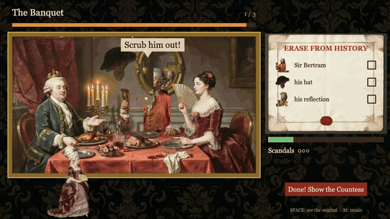

# Painted Out

*Confessions of a Royal Retoucher.* A browser game for **DreamLayer Jam #1**: scrub disgraced nobles out of royal oil paintings, and every trace they left, before the Countess turns around.

**Play:** https://lekhu701.itch.io/painted-out · about 8 minutes · Phaser 4 + TypeScript




## How DreamLayer made the paintings

Every painting is a DreamLayer **edit chain**, one reference and one change at a time:


1. `text_to_image`: the banquet, the master painting.
2. `image_to_image`: *"Keep this exact painting… remove only the man in the red coat."*
3. `image_to_image`: *"…remove the hat and the reflection in the mirror."* This is the clean plate.

New scenes (hunt, portrait, ballroom, picnic, finale) are `image_to_image` **from the banquet**, so the cast keeps the same faces. The Countess's front and back views come from one reference, and her walk is a DreamLayer **`sprite_sheet`** (12 frames). Its `atlas.json` loads straight into Phaser with `load.atlas`, and the game uses DreamLayer's `frame_durations_ms`.

## The problem: edits drift

DreamLayer edits re-render the whole image. Diffing "before" against "after" showed about **21% of pixels changing outside the edited region** (mean |Δ| = 16.6/255), and some edits came back reframed. Swapping whole images would shimmer.

## The solution: cut layers locally, stack them over the clean plate

`tools/cut_layers.py` turns an edit chain into transparent layers placed on the final clean plate:

| Method | Used for | How |
|---|---|---|
| `person` | people, animals | BiRefNet segmentation (rembg) inside a box |
| `diff` | objects (hat, cushion, basket) | pixels that differ from the clean plate (or from an intermediate edit), morphological closing, then the **largest connected blob** (drops drift speckle), feathered |
| `subject-diff` | a rider on a horse | the **intersection** of the subject mask and the diff: only what was actually removed |

Options include `exclude` zones (don't take the neighbour's fan), `hit` areas (count progress only on the target when a layer must carry someone else's pose), and edge erosion (no halos).

In-game, the layers are composited into a Phaser `RenderTexture` on top of the clean plate. Scrubbing *erases* into it, so the reveal is seamless. Progress samples only the layer's opaque pixels. On reverse days the stack is flipped.

**The product feature that would remove this workaround:** a masked or region-locked edit, or a change mask returned with each edit.

## Repo layout

```
game/        Phaser 4 + Vite + TS (scenes: Title, Play, Gallery; sfx.ts, music.ts)
tools/       cut_layers.py, cut_sprite.py, make_gallery.py, sync_art.sh, check_v3_api.sh (uv project)
art/scenes/  per-painting layer specs (JSON)
scripts/     zip.sh (itch HTML5 package)
docs/itch/   cover, gameplay GIF and edit-chain images
```

```bash
cd game && npm install && npm run dev                                  # play locally
cd tools && uv run python cut_layers.py ../art/scenes/banquet.json     # rebuild a painting's layers
```

## Credits

Solo project by Lekhraj Saini. Art: DreamLayer (API and MCP server, driven from Claude Code). Code written with Claude Code. Cut-outs: rembg/BiRefNet. Sound: ZzFX. Music: an original procedural harpsichord minuet (Web Audio).

> The original 2560px DreamLayer outputs (art/raw) are not included to keep the repo small; the cut layers the game uses are in `game/public/art/`, and every edit chain is shown in-game (press **G**).
